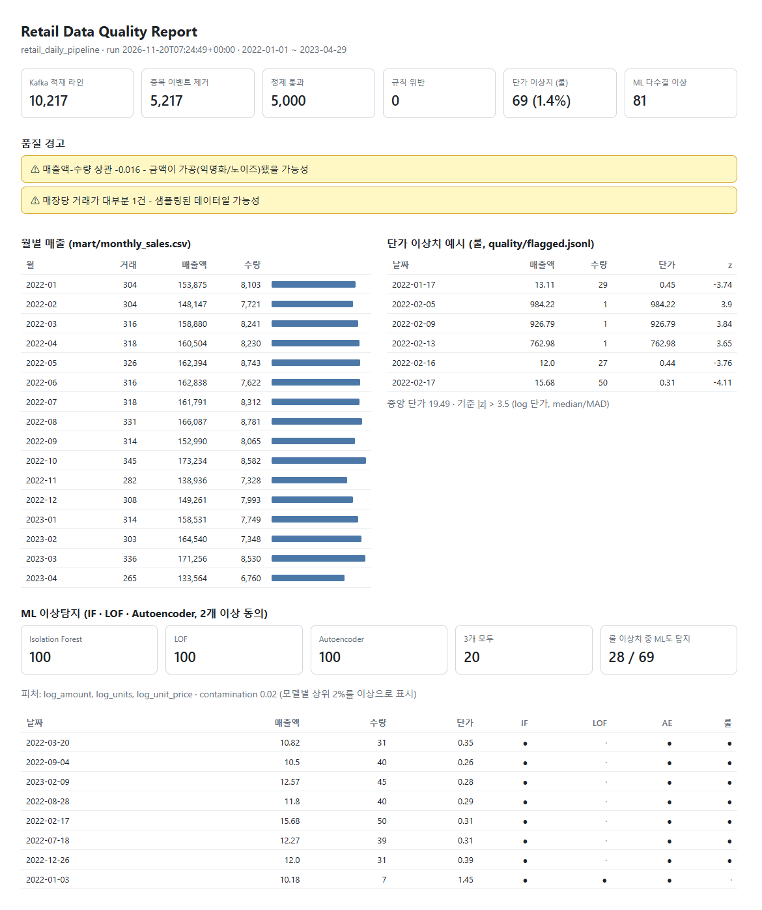

# customs-api-pipeline

Kafka 실시간 스트리밍 + Airflow 스케줄링 기반 데이터 파이프라인. 하나의 인프라 위에서 두 가지 파이프라인을 운영한다.

| 파이프라인 | 데이터 | 하는 일 | Airflow DAG |
|---|---|---|---|
| **① 관세 API 보안 로그** | 모의 관세 API 트래픽 (정상 + 공격) | 로그 수집 → 피처 추출 → IF·LOF·Autoencoder 앙상블 이상탐지 | `customs_api_pipeline` (5분마다) |
| **② 리테일 매출 ETL** | 실제 매출 거래 5,000건 | Kafka 재생 → 검증·정제 → 일·월 집계 마트 + 데이터 품질 리포트 | `retail_daily_pipeline` (매일 01:00) |

**핵심 포인트**

- 공격 IP(Shadow API 탐색, BOLA)를 **3개 모델 모두 이상으로 탐지**
- Kafka at-least-once 전달로 생긴 **재전달 중복 687건을 ETL에서 제거** (consumer 재시작 상황에서 실제 발생)
- 규칙 위반 비율이 임계치를 넘으면 DAG를 실패시키는 **품질 게이트**
- 원천 데이터 자체의 이상 신호(매출액-수량 무상관, 샘플링 흔적)를 **품질 리포트에 경고로 기록**


---

## 전체 아키텍처

```
 ① 관세 API (Flask)                         ② retail_sales_performance.csv
    정상 + Shadow API 탐색 + BOLA              날짜순 replay (초당 50건, key=store_id)
            │                                           │
     Kafka Producer                              Retail Producer
            │                                           │
            ▼                                           ▼
 ┌──────────────────────── Kafka (Confluent 7.6) ────────────────────────┐
 │  topic: customs-api-logs                     topic: retail-sales      │
 └───────────────────────────────────────────────────────────────────────┘
            │                                           │
     Kafka Consumer                              Retail Consumer
            ▼                                           ▼
 data/logs/api_logs.jsonl                 data/retail/raw/sales_events.jsonl
            │                                           │
 ┌──────────────────────── Airflow 2.9 ──────────────────────────────────┐
 │  customs_api_pipeline (5분)             retail_daily_pipeline (매일)  │
 │  check_log_file                         check_raw_events              │
 │   → run_anomaly_detection                → validate_clean_aggregate   │
 │   → print_results                        → quality_gate               │
 └───────────────────────────────────────────────────────────────────────┘
            ▼                                           ▼
 data/results/detection_results.jsonl     data/retail/{clean,quality,mart}/
```

---

## ① 관세 API 보안 로그 — 이상탐지

모의 관세 API(HS 코드 조회, 수입 통계, 수입 신고)에 정상 사용자 트래픽과 공격 트래픽을 섞어 보내고, 그 로그로 공격자를 찾는다.

**탐지 대상**

| 공격 유형 | 설명 |
|---|---|
| Shadow API 탐색 | 명세에 없는 경로 스캔 (`/admin`, `/internal/config` 등) |
| BOLA | 다른 사용자의 수입 통계를 ID를 바꿔가며 무단 조회 |

**탐지 방식** (`detector/`)

- **피처**: IP × 5분 윈도우 단위로 요청 수, 고유 경로 수, 에러 비율, 쓰기(POST) 비율, 엔드포인트 엔트로피 등을 집계
- **모델**: Isolation Forest · LOF · Autoencoder 세 가지를 각각 돌려 결과를 함께 기록

**결과**

```json
{"src_ip": "192.168.99.100", "req_count": 9, "uniq_paths": 3, "shadow_count": 9,
 "anomaly_if": true, "anomaly_lof": true, "anomaly_ae": true}
```

Shadow API 탐색 IP(`192.168.99.100`)와 BOLA IP(`10.0.0.55`)가 세 모델 모두에서 이상으로 탐지됐다.

| DAG 그래프 | DAG 실행 기록 |
|---|---|
|  |  |

---

## ② 리테일 매출 ETL — 데이터 품질

실제 매출 거래 데이터(5,000건, 2022-01 ~ 2023-04)를 Kafka로 실시간처럼 재생하고, Airflow가 매일 검증·정제·집계한다. 매 실행마다 raw 전체를 다시 계산하므로 몇 번을 돌려도 결과가 같다(idempotent).

**품질 규칙** (`etl/retail_etl.py`)

| 단계 | 규칙 | 처리 |
|---|---|---|
| 전달 중복 | 같은 `event_seq` 재수신 (Kafka at-least-once) | 제거 |
| 스키마 | 필수 컬럼 누락, 날짜·숫자 파싱 실패, 미래 날짜 | rejected |
| 값 범위 | 매출액·수량 ≤ 0, 소수 수량, 상한 초과 | rejected |
| 업무 중복 | 날짜·매장·상품·금액·수량이 동일한 거래 | rejected |
| 단가 이상치 | log(매출액/수량)의 robust z-score > 3.5 (median/MAD) | flagged (통과하되 표시) |
| 품질 게이트 | rejected 비율 > 5% | DAG 실패 처리 |

**출력**

| 경로 | 내용 |
|---|---|
| `clean/sales_clean.csv` | 검증 통과 거래 (+ 단가, z-score) |
| `quality/rejected.jsonl` | 규칙 위반 거래 + 사유 |
| `quality/flagged.jsonl` | 단가 이상치 거래 |
| `quality/report.json` | 품질 리포트 (건수, 비율, 경고) |
| `mart/daily_sales.csv`, `mart/monthly_sales.csv` | 일·월 매출 집계 |

**실행 결과**

| 지표 | 값 |
|---|---|
| 적재 라인 / 고유 이벤트 | 5,687 / 5,000 |
| Kafka 재전달 중복 제거 | 687건 (consumer 재시작 시 미커밋 오프셋 재수신) |
| 규칙 위반 | 0건 |
| 단가 이상치 | 69건 (1.4%) — 예: 1개에 984.22, 29개에 13.11 |
| 집계 | 484일 / 16개월 |

품질 리포트는 원천 데이터 자체의 특성도 경고로 남긴다. 매출액-수량 상관이 −0.016으로 거의 없고(금액 익명화·노이즈 가능성), 3,834개 매장 대부분이 거래 1건뿐이다(샘플링 가능성). 그래서 매장·상품 단위 분석보다 **파이프라인과 데이터 품질 검증**에 초점을 맞췄다.



> 위 화면은 `quality/report.json`, `quality/flagged.jsonl`, `mart/monthly_sales.csv`를 `tools/screenshot_retail.js`가 HTML로 그려 캡처한 것이다. 같은 경고는 Airflow `quality_gate` 태스크 로그에도 출력된다.

| DAG 그래프 | 품질 게이트 로그 |
|---|---|
|  |  |

---

## 빠른 시작

```bash
git clone https://github.com/zeldaim/customs-api-pipeline.git
cd customs-api-pipeline

# ② 리테일 파이프라인을 쓰려면 원본 CSV를 먼저 둔다 (저장소에는 포함하지 않음)
mkdir -p data/raw && cp /path/to/retail_sales_performance.csv data/raw/

docker compose up -d --build
```

| 서비스 | 주소 |
|---|---|
| Airflow UI | http://localhost:8081 (admin / admin) |
| 관세 API | http://localhost:8080/api/v1/health |

리테일 DAG는 매일 01:00에 돈다. 바로 확인하려면 Airflow UI에서 `retail_daily_pipeline`을 수동 실행(▶)한다.

## 파일 구조

```
customs-api-pipeline/
├── api/                  # 모의 관세 API (Flask)
├── kafka/                # Producer / Consumer (관세 + 리테일)
├── detector/             # ① 피처 추출 + IF·LOF·Autoencoder 이상탐지
├── etl/                  # ② 리테일 검증·정제·집계
├── airflow/dags/         # customs_pipeline.py, retail_daily_pipeline.py
├── data/                 # 실행 결과 (git 제외)
│   ├── logs/             #   ① Kafka 적재 로그
│   ├── results/          #   ① 탐지 결과
│   ├── raw/              #   ② 원본 CSV
│   └── retail/           #   ② raw / clean / quality / mart
├── docs/
│   ├── screenshots/
│   └── troubleshooting.md
├── tools/                # 스크린샷 자동화 (Puppeteer)
└── docker-compose.yml
```

## 스택

- **Kafka** 7.6.0 (Confluent) + Zookeeper
- **Airflow** 2.9.1 (SequentialExecutor, SQLite — 로컬 개발용)
- **Python** 3.11 — kafka-python, pandas, scikit-learn, Flask
- **Docker Compose**

## 트러블슈팅

구축 중 겪은 오류와 해결 과정은 [docs/troubleshooting.md](docs/troubleshooting.md)에 정리했다.
