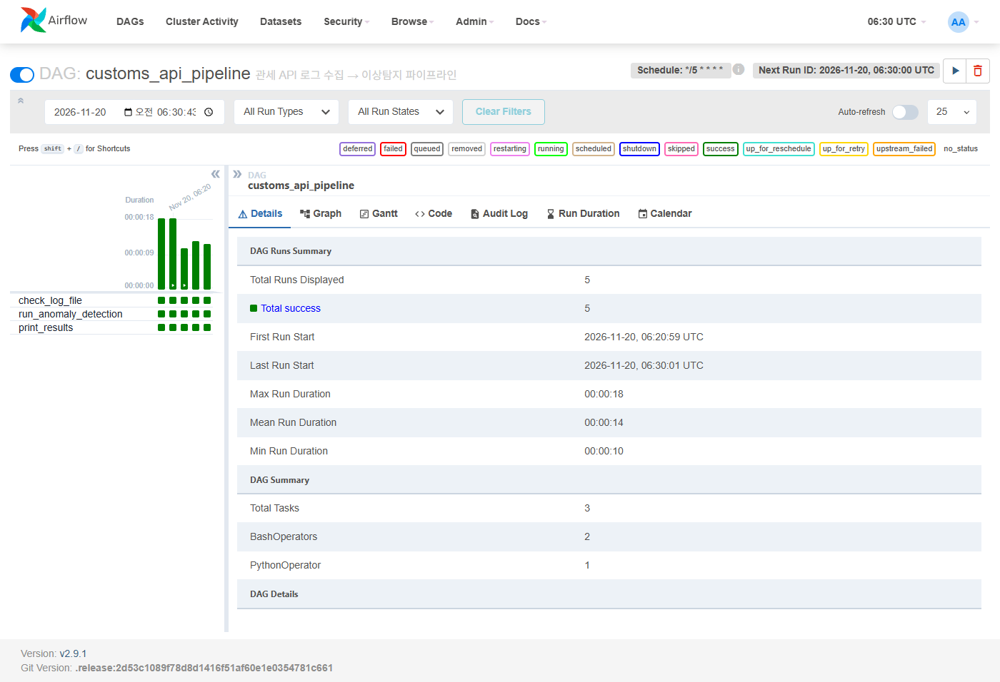
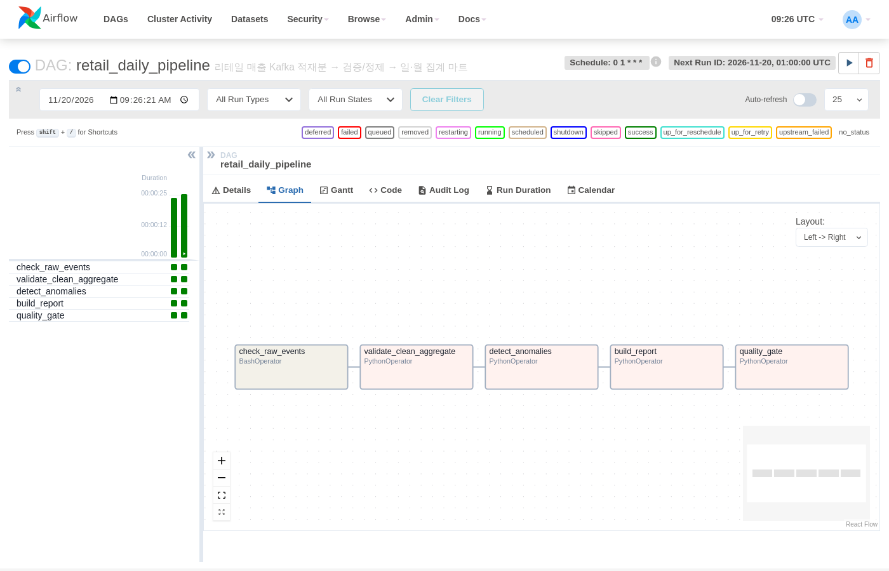
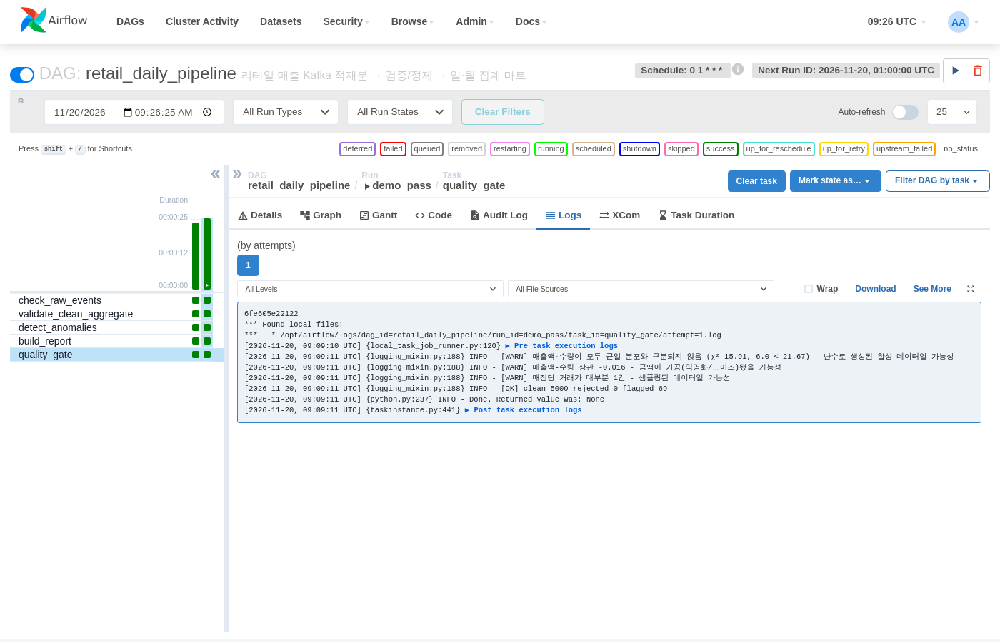

# customs-api-pipeline

Kafka 실시간 스트리밍 + Airflow 스케줄링 기반 데이터 파이프라인. 하나의 인프라 위에서 두 가지 파이프라인을 운영한다.

| 파이프라인 | 데이터 | 하는 일 | Airflow DAG |
|---|---|---|---|
| **① 관세 API 보안 로그** | 모의 관세 API 트래픽 (정상 + 공격) | 로그 수집 → 피처 추출 → IF·LOF·Autoencoder 앙상블 이상탐지 | `customs_api_pipeline` (5분마다) |
| **② 리테일 매출 ETL** | Airflow 튜토리얼 매출 데이터 5,000건 (합성) | Kafka 재생 → 검증·정제 → 일·월 집계 → **품질 리포트** (+ 같은 ML 앙상블로 거래 이상탐지) | `retail_daily_pipeline` (매일 01:00) |

**핵심 포인트**

- **품질 리포트가 원천 데이터의 문제를 먼저 찾아냄** — 매 실행마다 HTML 리포트 한 장을 만들고, 그 리포트에서 ① 이벤트가 두 배로 적재된 장애와 ② 원천 데이터가 합성(컬럼별 독립 난수)이라는 사실이 드러남
- producer 재실행으로 **같은 이벤트가 5,217건 중복 적재된 장애를 ETL이 `event_seq`로 걸러냄** → 원인을 찾아 producer에 체크포인트 추가
- 규칙 위반 비율이 임계치를 넘으면 DAG를 실패시키는 **품질 게이트**
- 공격 IP(Shadow API 탐색, BOLA)를 **3개 모델 모두 이상으로 탐지**
- 관세 파이프라인의 **IF·LOF·Autoencoder 모듈을 리테일에 그대로 재사용**하고, 룰 기반 결과와 비교


---

## 전체 아키텍처

```
 ① 관세 API (Flask)                         ② retail_sales_performance.csv
    정상 + Shadow API 탐색 + BOLA              날짜순 replay (초당 50건, key=store_id)
            │                                           │
     Kafka Producer                              Retail Producer
            │                                           │
            ▼                                           ▼
 ┌──────────────────────── Kafka (Confluent 7.6) ────────────────────────┐
 │  topic: customs-api-logs                     topic: retail-sales      │
 └───────────────────────────────────────────────────────────────────────┘
            │                                           │
     Kafka Consumer                              Retail Consumer
            ▼                                           ▼
 data/logs/api_logs.jsonl                 data/retail/raw/sales_events.jsonl
            │                                           │
 ┌──────────────────────── Airflow 2.9 ──────────────────────────────────┐
 │  customs_api_pipeline (5분)             retail_daily_pipeline (매일)  │
 │  check_log_file                         check_raw_events              │
 │   → run_anomaly_detection                → validate_clean_aggregate   │
 │   → print_results                        → quality_gate │ 병렬        │
 │                                            detect_anomalies │         │
 │                                          → build_report (HTML)        │
 └───────────────────────────────────────────────────────────────────────┘
            ▼                                           ▼
 data/results/detection_results.jsonl     data/retail/{clean,quality,mart}/
```

---

## ① 관세 API 보안 로그 — 이상탐지

모의 관세 API(HS 코드 조회, 수입 통계, 수입 신고)에 정상 사용자 트래픽과 공격 트래픽을 섞어 보내고, 그 로그로 공격자를 찾는다.

**탐지 대상**

| 공격 유형 | 설명 |
|---|---|
| Shadow API 탐색 | 명세에 없는 경로 스캔 (`/admin`, `/internal/config` 등) |
| BOLA | 다른 사용자의 수입 통계를 ID를 바꿔가며 무단 조회 |

**탐지 방식** (`detector/`)

- **피처**: IP × 5분 윈도우 단위로 요청 수, 고유 경로 수, 에러 비율, 쓰기(POST) 비율, 엔드포인트 엔트로피 등을 집계
- **모델**: Isolation Forest · LOF · Autoencoder 세 가지를 각각 돌려 결과를 함께 기록

**결과**

```json
{"src_ip": "192.168.99.100", "req_count": 9, "uniq_paths": 3, "shadow_count": 9,
 "anomaly_if": true, "anomaly_lof": true, "anomaly_ae": true}
```

Shadow API 탐색 IP(`192.168.99.100`)와 BOLA IP(`10.0.0.55`)가 세 모델 모두에서 이상으로 탐지됐다.

| DAG 그래프 | DAG 실행 기록 |
|---|---|
|  |  |

---

## ② 리테일 매출 ETL — 데이터 품질 리포트

Airflow 튜토리얼에서 쓰는 매출 데이터(`retail_sales_performance.csv`, 5,000건, 2022-01 ~ 2023-04)를 Kafka로 실시간처럼 재생하고, Airflow가 매일 검증·정제·집계한다. 매 실행마다 raw 전체를 다시 계산하므로 몇 번을 돌려도 결과가 같다(idempotent).

이 파이프라인의 최종 산출물은 집계 테이블이 아니라 **품질 리포트**다. 데이터를 믿고 써도 되는지를 먼저 판단하고, 그 판단에 따라 무엇을 분석할지 정한다.

### 품질 리포트

DAG의 마지막 태스크 `build_report`(`etl/retail_report.py`)가 매 실행마다 외부 리소스 없는 HTML 한 장(`quality/report.html`)을 만든다. 아래는 그 파일을 그대로 캡처한 것이다.


| 리포트 영역 | 보여주는 것 | 이번 실행에서 드러난 것 |
|---|---|---|
| 적재·정제 KPI | Kafka 적재 라인 → 중복 제거 → 정제 통과 / 규칙 위반 | 적재 10,217 vs 고유 이벤트 5,000 → **중복 적재 장애 발견** (아래) |
| 품질 경고 | 원천 데이터 자체의 이상 신호 | 매출액-수량 상관 **−0.016**, 매장 3,834개에 거래 5,000건 → **원천 데이터 의심** (아래) |
| 단가 이상치 | log 단가 robust z-score > 3.5 | 69건 (1.4%) — 예: 1개에 984.22, 29개에 13.11 |
| ML 이상탐지 | IF·LOF·AE 다수결, 룰과의 겹침 | 81건, 룰 이상치 69건 중 28건 겹침 |
| 월별 매출 | mart 집계 | 16개월 |

### 리포트가 잡아낸 것 ① — 원천 데이터는 합성이다

매출액과 판매수량은 보통 강하게 같이 움직인다. 리포트가 상관 −0.016과 "매장당 거래 대부분 1건" 경고를 띄워서, 원본 CSV의 분포를 직접 확인했다.

| 항목 | 관측값 | 실제 거래 데이터라면 |
|---|---|---|
| 매출액 | 10.18 ~ 999.88 구간에 **균일** (10개 구간 각 457~553건, 평균 503 ≈ 중앙값 498) | 소액이 많고 고액이 드문 오른쪽 꼬리 분포 |
| 판매수량 | 1 ~ 50 구간에 **균일** (10개 구간 각 466~533건) | 1~2개에 몰림 |
| 매출액-수량 상관 | −0.016 | 강한 양의 상관 |
| store_id / product_id | 1000~9997 / 10001~99943 범위에서 무작위, 상품 5,000건 중 4,869개가 서로 다름 | 고정된 매장·인기 상품이 반복 |
| 요일·월 | 요일별 684~743건, 월별 265~345건으로 평평, 12월 피크 없음 | 주말·연말 차이 |

컬럼마다 독립된 난수로 만든 데이터다. 그래서 이 데이터로 매장·상품·추세 분석은 하지 않고 **파이프라인과 품질 검증의 입력으로만 쓴다.** 리포트 없이 집계 결과만 봤다면 평평한 월별 매출을 "안정적인 매출"로 잘못 해석했을 것이다.

### 리포트가 잡아낸 것 ② — 중복 적재 장애

리포트에서 적재 라인(10,217)이 고유 이벤트(5,000)의 두 배 가까이 나왔다. 확인해 보니 `docker compose up`으로 consumer를 재시작할 때 이미 끝난 producer도 다시 실행되면서 5,000건을 처음부터 다시 보낸 것이었다. ETL은 `event_seq` 기준으로 중복을 제거하고 있어서 정제 결과(5,000건)와 집계는 영향을 받지 않았다. 원인을 막기 위해 producer가 브로커에 flush한 마지막 `event_seq`를 체크포인트 파일에 기록하고 재시작하면 그다음부터 보내도록 고쳤다 — 이제 다시 실행해도 `already replayed, nothing to send`로 끝난다. ETL의 중복 제거는 Kafka 재전달 같은 다른 경로를 위한 안전장치로 남겨 둔다.

| DAG 그래프 | 품질 게이트 로그 |
|---|---|
|  |  |

### 품질 규칙 (`etl/retail_etl.py`)

| 단계 | 규칙 | 처리 |
|---|---|---|
| 이벤트 중복 | 같은 `event_seq`가 여러 번 적재 (producer 재실행, Kafka 재전달) | 제거 |
| 스키마 | 필수 컬럼 누락, 날짜·숫자 파싱 실패, 미래 날짜 | rejected |
| 값 범위 | 매출액·수량 ≤ 0, 소수 수량, 상한 초과 | rejected |
| 업무 중복 | 날짜·매장·상품·금액·수량이 동일한 거래 | rejected |
| 단가 이상치 | log(매출액/수량)의 robust z-score > 3.5 (median/MAD) | flagged (통과하되 표시) |
| 품질 게이트 | rejected 비율 > 5% | DAG 실패 처리 |

### 출력

| 경로 | 내용 |
|---|---|
| `clean/sales_clean.csv` | 검증 통과 거래 (+ 단가, z-score) |
| `quality/rejected.jsonl` | 규칙 위반 거래 + 사유 |
| `quality/flagged.jsonl` | 단가 이상치 거래 |
| **`quality/report.html`** | **위 결과를 모은 HTML 품질 리포트 (`build_report` 태스크)** |
| `quality/report.json` | 리포트 원본 수치 (건수, 비율, 경고) |
| `quality/ml_anomalies.jsonl`, `quality/ml_summary.json` | ML 이상탐지 결과, 룰과의 비교 |
| `mart/daily_sales.csv`, `mart/monthly_sales.csv` | 일·월 매출 집계 |

**실행 결과**

| 지표 | 값 |
|---|---|
| 적재 라인 / 고유 이벤트 | 10,217 / 5,000 |
| 중복 이벤트 제거 | 5,217건 |
| 규칙 위반 | 0건 |
| 단가 이상치 | 69건 (1.4%) |
| 집계 | 484일 / 16개월 |

### ML 이상탐지 (`etl/retail_anomaly.py`)

관세 파이프라인의 `detector/models.py`(IF · LOF · Autoencoder)를 그대로 가져다 쓴다. 피처는 log(매출액), log(수량), log(단가), 모델별 상위 2%를 이상으로 보고 **3개 중 2개 이상 동의한 거래**만 남긴다.

| 지표 | 값 |
|---|---|
| 모델별 이상 | IF 100 · LOF 100 · AE 100 |
| 2개 이상 동의 / 3개 모두 | 81 / 20 |
| 룰(단가 z-score) 이상치 69건 중 ML도 잡은 것 | 28건 (41%) |

해석: 단가가 극단적인 거래(예: 31개에 10.82)는 룰과 ML이 함께 잡는다. 나머지 ML 결과는 금액·수량이 범위 끝에 있는 거래들이다. 데이터가 균일 난수라 '정상 패턴'이 없으니 당연한 결과다. contamination을 정하면 모델은 항상 그 비율만큼 이상을 내놓으므로, ML 결과는 단독 근거로 쓰지 않고 **룰 결과와 겹치는 정도를 리포트에 함께 표시**한다.

---

## 빠른 시작

```bash
git clone https://github.com/zeldaim/customs-api-pipeline.git
cd customs-api-pipeline

# ② 리테일 파이프라인을 쓰려면 원본 CSV를 먼저 둔다 (저장소에는 포함하지 않음)
mkdir -p data/raw && cp /path/to/retail_sales_performance.csv data/raw/

docker compose up -d --build
```

| 서비스 | 주소 |
|---|---|
| Airflow UI | http://localhost:8081 (admin / admin) |
| 관세 API | http://localhost:8080/api/v1/health |

리테일 DAG는 매일 01:00에 돈다. 바로 확인하려면 Airflow UI에서 `retail_daily_pipeline`을 수동 실행(▶)한다.

## 파일 구조

```
customs-api-pipeline/
├── api/                  # 모의 관세 API (Flask)
├── kafka/                # Producer / Consumer (관세 + 리테일)
├── detector/             # ① 피처 추출 + IF·LOF·Autoencoder 이상탐지
├── etl/                  # ② 리테일 검증·정제·집계
├── airflow/dags/         # customs_pipeline.py, retail_daily_pipeline.py
├── data/                 # 실행 결과 (git 제외)
│   ├── logs/             #   ① Kafka 적재 로그
│   ├── results/          #   ① 탐지 결과
│   ├── raw/              #   ② 원본 CSV
│   └── retail/           #   ② raw / clean / quality / mart
├── docs/
│   ├── screenshots/
│   └── troubleshooting.md
├── tools/                # 스크린샷 자동화 (Puppeteer)
└── docker-compose.yml
```

## 스택

- **Kafka** 7.6.0 (Confluent) + Zookeeper
- **Airflow** 2.9.1 (SequentialExecutor, SQLite — 로컬 개발용)
- **Python** 3.11 — kafka-python, pandas, scikit-learn, Flask
- **Docker Compose**

## 트러블슈팅

구축 중 겪은 오류와 해결 과정은 [docs/troubleshooting.md](docs/troubleshooting.md)에 정리했다.
