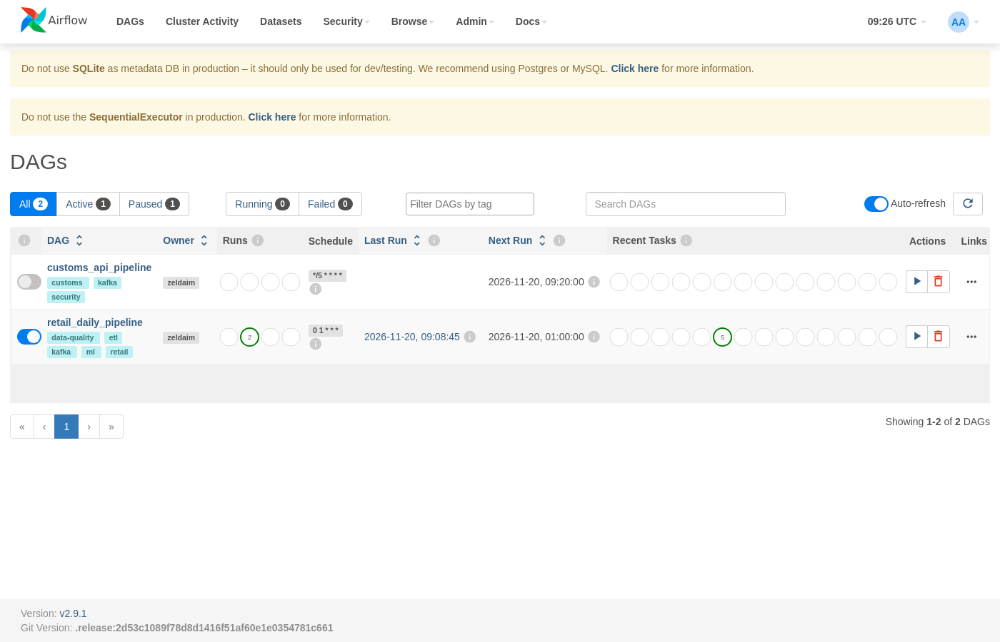
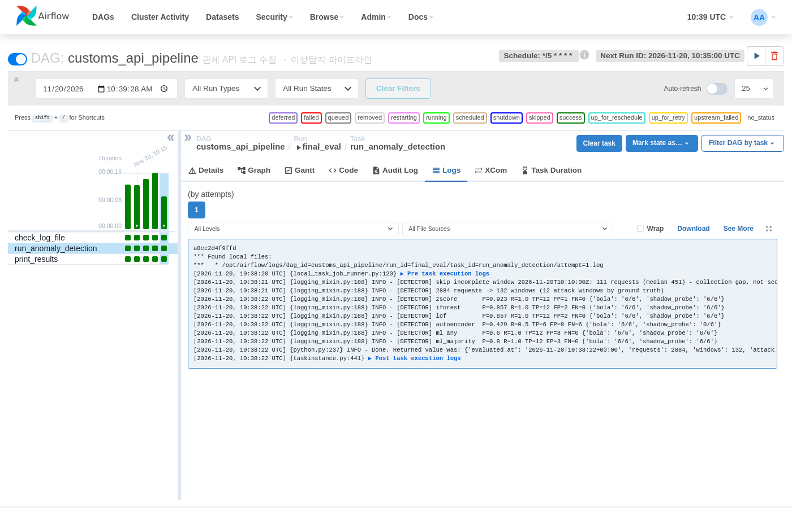
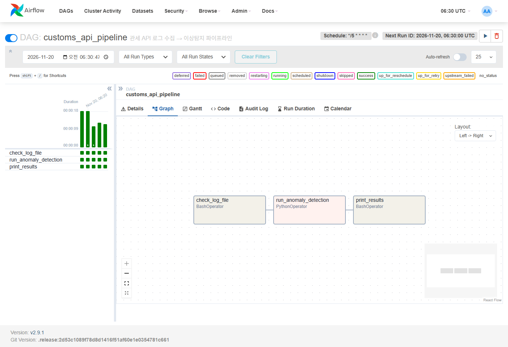
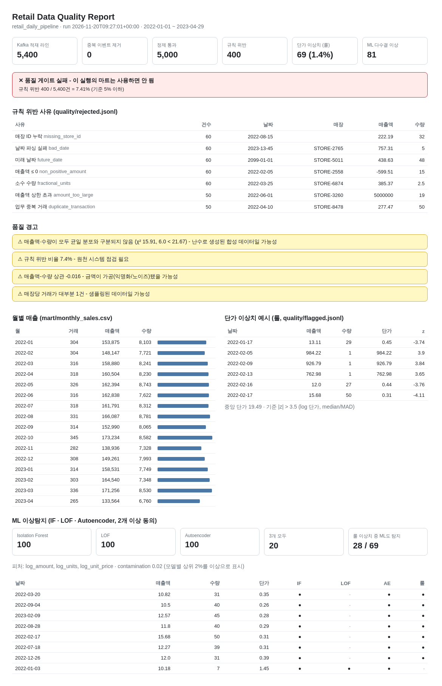
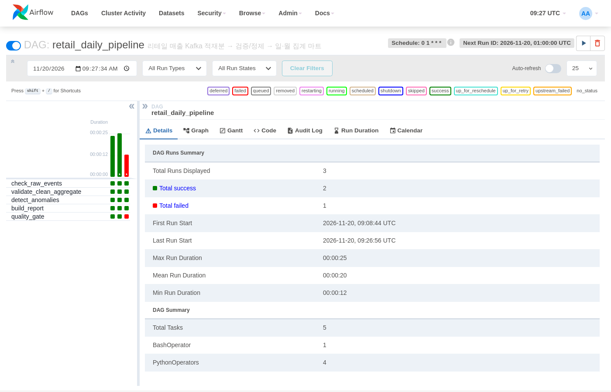
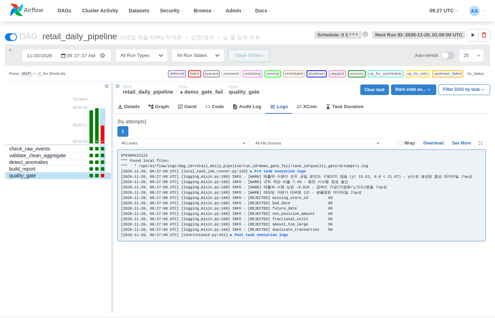

# customs-api-pipeline

Kafka 실시간 스트리밍 + Airflow 스케줄링 기반 데이터 파이프라인. 하나의 인프라 위에서 두 가지 파이프라인을 운영한다.

| 파이프라인 | 데이터 | 하는 일 | Airflow DAG |
|---|---|---|---|
| **① 관세 API 보안 로그** | 모의 관세 API가 직접 남긴 access log (정상 + 공격 트래픽) | 로그 수집 → 피처 추출 → z-score 비교군 + IF·LOF·Autoencoder → 정답 라벨로 precision/recall 평가 | `customs_api_pipeline` (5분마다) |
| **② 리테일 매출 ETL** | Airflow 튜토리얼 매출 데이터 5,000건 (합성) | Kafka 재생 → 검증·정제 → 일·월 집계 → **품질 리포트** (+ 같은 ML 앙상블로 거래 이상탐지) | `retail_daily_pipeline` (매일 01:00) |

**핵심 포인트**

- **품질 리포트가 원천 데이터의 문제를 먼저 찾아냄** — 매 실행마다 HTML 리포트 한 장을 만들고, 그 리포트에서 ① 원천 데이터가 합성(컬럼별 독립 난수)이라는 사실(균일 분포 χ² 검사로 자동 경고)과 ② 이벤트가 두 배로 적재된 장애가 드러남
- 규칙 위반 비율이 5%를 넘으면 DAG를 실패시키는 **품질 게이트** — 불량 이벤트 400건(7종)을 Kafka로 주입해 **게이트가 실제로 DAG를 멈추는 것까지 확인**
- producer 재실행으로 **같은 이벤트가 5,217건 중복 적재된 장애를 ETL이 `event_seq`로 걸러냄** → 원인을 찾아 producer에 체크포인트 추가
- 관세 API 탐지는 **서버가 남긴 access log만** 피처로 쓰고, 정답 라벨은 분리해 **precision/recall로 평가** — 결과는 ML이 아닌 robust z-score(P 0.923, R 1.0)가 IF·LOF(P 0.857)보다 낫고, IF·LOF는 contamination 설정에 따라 크게 흔들림 (이전 버전의 라벨 누수 제거)
- 수집 공백(호스트 일시정지)이 오탐으로 번지는 것을 실측하고, **완료되지 않은 윈도우·수집 공백 윈도우를 채점에서 빼는 검사** 추가
- 관세 파이프라인의 **IF·LOF·Autoencoder 모듈을 리테일에 그대로 재사용**하고, 룰 기반 결과와 비교
- **공급망 CI** — API-BOM(소스↔승인 기준선 게이트) · 이미지 SBOM · 취약점 · 빌드 재현성을 CycloneDX 1.6 으로 만들고 보고서 한 장으로 정리. 자기 레포를 검사해 **Airflow 2.x 지원 종료**, **시작할 때마다 `pip install` → 실행 코드가 SBOM 밖**인 문제를 찾음



---

## 전체 아키텍처

```
 트래픽 생성기 ──▶ 정답 라벨                  ② retail_sales_performance.csv
 (정상 + Shadow      data/labels/ (평가 전용)     날짜순 replay (초당 50건, key=store_id)
  API 탐색 + BOLA)                                      │
            │ HTTP (X-Forwarded-For)                    │
            ▼                                           │
 ① 관세 API (Flask) — access log 를 직접 전송     Retail Producer
            │                                           │
            ▼                                           ▼
 ┌──────────────────────── Kafka (Confluent 7.6) ────────────────────────┐
 │  topic: customs-api-logs                     topic: retail-sales      │
 └───────────────────────────────────────────────────────────────────────┘
            │                                           │
     Kafka Consumer                              Retail Consumer
            ▼                                           ▼
 data/logs/api_logs.jsonl                 data/retail/raw/sales_events.jsonl
            │                                           │
 ┌──────────────────────── Airflow 2.9 ──────────────────────────────────┐
 │  customs_api_pipeline (5분)             retail_daily_pipeline (매일)  │
 │  check_log_file                         check_raw_events              │
 │   → run_anomaly_detection                → validate_clean_aggregate   │
 │   → print_results                        → detect_anomalies           │
 │                                          → build_report (HTML)        │
 │                                          → quality_gate (판정)        │
 └───────────────────────────────────────────────────────────────────────┘
            ▼                                           ▼
 data/results/{detection_results.jsonl,   data/retail/{clean,quality,mart}/
               evaluation.json}
```

---

## ① 관세 API 보안 로그 — 이상탐지

모의 관세 API(HS 코드 조회, 수입 통계, 수입 신고)에 정상 사용자 트래픽과 공격 트래픽을 섞어 보내고, **API 서버가 남긴 access log만으로** 공격 IP를 찾는다. 정답 라벨은 따로 보관했다가 평가에만 쓴다.

**탐지 대상**

| 공격 유형 | 설명 |
|---|---|
| Shadow API 탐색 | 명세에 없는 경로 스캔 (`/admin`, `/internal/config` 등) — 30 tick마다 3건 |
| BOLA | 다른 사용자의 수입 통계를 ID를 바꿔가며 무단 조회 (`user_1`~`user_9`) — 50 tick마다 9건 |

정상 사용자 20명은 IP가 고정이고, HS 코드 조회·본인 통계 조회·수입 신고를 섞어 보낸다. HS 코드는 10% 확률로 오타를 내서 정상 사용자도 404를 낸다. 모든 클라이언트의 User-Agent는 같다.

### 로그와 라벨의 분리

| | 누가 만드나 | 들어가는 것 | 쓰는 곳 |
|---|---|---|---|
| access log (`data/logs/api_logs.jsonl`) | **API 서버** (`after_request` 훅 → Kafka) | 시각, IP(`X-Forwarded-For`), 메서드, 경로, 상태코드, 응답 크기, 지연, UA | 피처 → 탐지 |
| 정답 라벨 (`data/labels/ground_truth.jsonl`) | 트래픽 생성기 | 시각, IP, `actor_type` (normal / shadow_probe / bola) | **평가에만** |

> **이전 버전의 문제 (라벨 누수)** — 예전에는 트래픽 생성기가 로그를 직접 만들어 Kafka에 넣었고, 그 로그에 정답(`actor_type`)이 들어 있었다. 피처 `shadow_count`·`bola_count`가 그 정답을 세는 값이라 모델이 답을 보고 탐지하는 구조였고, "3개 모델 모두 탐지"라는 결과는 의미가 없었다. 지금은 로그를 서버가 만들고, 피처는 서버가 관찰할 수 있는 값만 쓴다.

### 탐지 방식 (`detector/`)

- **피처** (IP × 5분 윈도우): 요청 수, 고유 경로 수, 4xx/5xx 비율, POST 비율, 엔드포인트 엔트로피, 같은 엔드포인트에서 조회한 서로 다른 객체 ID 수(`/import-stats/{id}`)
- **방법**: robust z-score(ML이 아닌 비교군, 피처별 median/MAD 중 최대 |z| ≥ 3) · Isolation Forest · LOF · Autoencoder (모델은 `detector/models.py`, contamination 0.1). 앙상블은 ML 3개 중 하나라도(`ml_any`) / 2개 이상(`ml_majority`)
- **윈도우 처리**: 끝나지 않은 윈도우는 채점하지 않는다. 전체 요청 수가 중앙값의 절반 미만인 윈도우는 **수집 공백**으로 보고 채점에서 빼고 따로 알린다.
- **평가**: 정답 라벨을 (IP, 윈도우)에 붙여 방법별 TP/FP/FN, precision/recall, 공격 유형별 탐지율을 `data/results/evaluation.json`에 기록. 결과 파일은 매 실행 전체 재계산 후 덮어쓴다.

### 결과

수집 약 30분, 요청 2,884건 → 채점 윈도우 132개(IP 22개 × 6구간), 그중 공격 윈도우 12개 (Shadow 6, BOLA 6).

| 방법 | Precision | Recall | 오탐 | BOLA | Shadow 탐색 |
|---|---|---|---|---|---|
| **robust z-score (비교군, ML 아님)** | **0.923** | **1.0** | 1 | 6/6 | 6/6 |
| Isolation Forest | 0.857 | 1.0 | 2 | 6/6 | 6/6 |
| LOF | 0.857 | 1.0 | 2 | 6/6 | 6/6 |
| Autoencoder | 0.429 | 0.5 | 8 | 6/6 | **0/6** |
| ML 2개 이상 동의 | 0.8 | 1.0 | 3 | 6/6 | 6/6 |
| ML 하나라도 | 0.6 | 1.0 | 8 | 6/6 | 6/6 |



**해석 — ML이 비교군보다 낫지 않다**

1. **ML이 아닌 z-score가 가장 좋다.** 공격이 피처 한두 개에서 극단값으로 드러나는 단순한 시나리오라서다. BOLA는 객체 ID 9개(정상 사용자는 1개), Shadow 탐색은 에러 비율 100%(정상 평균 5.1%).
2. **IF·LOF 결과는 contamination 설정에 달려 있다.** 공격 윈도우 비율(12/132 = 9%)이 contamination 0.1과 우연히 비슷해서 좋아 보이는 것이다. 같은 데이터로 값만 바꾸면:

   | contamination | IF P / R | LOF P / R | z-score P / R |
   |---|---|---|---|
   | 0.05 | 1.0 / 0.583 | 1.0 / 0.5 | 0.923 / 1.0 |
   | 0.1 | 0.857 / 1.0 | 0.857 / 1.0 | 0.923 / 1.0 |
   | 0.2 | 0.444 / 1.0 | 0.444 / 1.0 | 0.923 / 1.0 |

   실제 환경에서는 공격 비율을 모르므로 이 값을 맞출 수 없다. z-score는 이 설정과 무관하다.
3. **Autoencoder는 Shadow 탐색을 하나도 못 잡는다.** 요청 3~12건짜리 소규모 윈도우는 재구성 오차가 크지 않다. 반대로 정상 윈도우 8개를 오탐한다.
4. **표본이 작다.** 공격 윈도우 12개, 공격 IP 2개뿐이라 수치 하나하나에 큰 의미를 두면 안 된다. 공격자가 정상처럼 섞여 들어오는 시나리오(저속 BOLA, 정상 요청에 섞인 스캔)를 추가해야 ML의 쓸모를 제대로 따질 수 있다.

**수집 공백 — 실측**

수집 중 호스트가 두 번 멈췄다(10:08~10:14, 10:19~10:38). 로그와 정답 라벨 건수가 끝까지 1:1로 일치해서 API → Kafka → 파일 구간의 **유실은 0건**이었다. 하지만 공백이 낀 10:10 윈도우는 IP당 요청이 2~9건(평소 중앙값 21)으로 줄었고, 이 윈도우까지 채점하면 결과가 이렇게 무너진다.

| 10:10 윈도우 포함 시 | Precision | Recall |
|---|---|---|
| z-score | 0.583 | 1.0 |
| Isolation Forest | 0.625 | 0.714 |
| Autoencoder | 0.188 | 0.214 |

수집 공백은 공격이 아니라 파이프라인 문제로 따로 알려야 한다. 그래서 수집 공백 검사(`drop_incomplete_windows`)를 넣어 해당 윈도우를 채점에서 빼고 로그에 `skip incomplete window ... collection gap`으로 남긴다. 검사를 끄려면 `CUSTOMS_SKIP_INCOMPLETE=0`. 비슷하게, 처음에는 끝나지 않은 윈도우(1분만 지난 윈도우)까지 채점해서 오탐 19건 중 18건이 그 윈도우에서 나왔다. 이것도 고쳤다.

| DAG 그래프 | DAG 실행 기록 |
|---|---|
|  |  |

---

## ② 리테일 매출 ETL — 데이터 품질 리포트

Airflow 튜토리얼에서 쓰는 매출 데이터(`retail_sales_performance.csv`, 5,000건, 2022-01 ~ 2023-04)를 Kafka로 실시간처럼 재생하고, Airflow가 매일 검증·정제·집계한다. 매 실행마다 raw 전체를 다시 계산하므로 몇 번을 돌려도 결과가 같다(idempotent).

이 파이프라인의 최종 산출물은 집계 테이블이 아니라 **품질 리포트**다. 데이터를 믿고 써도 되는지를 먼저 판단하고, 그 판단에 따라 무엇을 분석할지 정한다.

### 품질 리포트

DAG의 마지막 태스크 `build_report`(`etl/retail_report.py`)가 매 실행마다 외부 리소스 없는 HTML 한 장(`quality/report.html`)을 만든다. 아래는 그 파일을 그대로 캡처한 것이다.


| 리포트 영역 | 보여주는 것 | 드러난 것 |
|---|---|---|
| 적재·정제 KPI | Kafka 적재 라인 → 중복 제거 → 정제 통과 / 규칙 위반 | 초기 실행에서 적재 10,217 vs 고유 이벤트 5,000 → **중복 적재 장애 발견** (아래) |
| 게이트 판정 | 규칙 위반 비율과 통과/실패 배너 | 정상 0% 통과 / 불량 주입 시 7.41% **실패** (아래) |
| 규칙 위반 사유 | 사유별 건수와 실제 불량 예시 (위반이 있을 때만) | 주입한 7종이 각각 정확한 건수로 잡힘 |
| 품질 경고 | 원천 데이터 자체의 이상 신호 | **균일 분포 χ² 15.91·6.0**, 매출액-수량 상관 **−0.016**, 매장 3,834개에 거래 5,000건 → **합성 데이터** (아래) |
| 단가 이상치 | log 단가 robust z-score > 3.5 | 69건 (1.4%) — 예: 1개에 984.22, 29개에 13.11 |
| ML 이상탐지 | IF·LOF·AE 다수결, 룰과의 겹침 | 81건, 룰 이상치 69건 중 28건 겹침 |
| 월별 매출 | mart 집계 | 16개월 |

### 리포트가 잡아낸 것 ① — 원천 데이터는 합성이다

실제 거래라면 금액·수량은 소액·소량 쪽에 몰리고, 둘이 강하게 같이 움직인다. 리포트는 매 실행마다 세 가지를 자동으로 검사해 경고한다.

- **균일 분포 검사** — 매출액·수량을 각각 같은 폭 10구간으로 나눠 균일 분포 기대 빈도와 카이제곱을 계산. 둘 다 21.67(자유도 9, 유의수준 1%) 미만이면 경고. 이 데이터는 χ² 15.91 / 6.0. 비교로 로그정규 금액·지수분포 수량 5,000건은 χ²가 수만이라 경고가 나지 않는다.
- **매출액-수량 상관** — |r| < 0.2 이면 경고. 이 데이터는 −0.016.
- **매장 분산도** — 매장 수가 거래 수의 절반을 넘으면 경고. 3,834개 / 5,000건.

경고를 보고 나머지 분포도 확인했다.

| 항목 | 관측값 | 실제 거래 데이터라면 |
|---|---|---|
| 매출액 | 10.18 ~ 999.88 구간에 **균일** (10개 구간 각 457~553건, 평균 503 ≈ 중앙값 498) | 소액이 많고 고액이 드문 오른쪽 꼬리 분포 |
| 판매수량 | 1 ~ 50 구간에 **균일** (10개 구간 각 466~533건) | 1~2개에 몰림 |
| 매출액-수량 상관 | −0.016 | 강한 양의 상관 |
| store_id / product_id | 1000~9997 / 10001~99943 범위에서 무작위, 상품 5,000건 중 4,869개가 서로 다름 | 고정된 매장·인기 상품이 반복 |
| 요일·월 | 요일별 684~743건, 월별 265~345건으로 평평, 12월 피크 없음 | 주말·연말 차이 |

컬럼마다 독립된 난수로 만든 데이터다. 그래서 이 데이터로 매장·상품·추세 분석은 하지 않고 **파이프라인과 품질 검증의 입력으로만 쓴다.** 리포트 없이 집계 결과만 봤다면 평평한 월별 매출을 "안정적인 매출"로 잘못 해석했을 것이다.

### 리포트가 잡아낸 것 ② — 중복 적재 장애

초기 실행의 리포트에서 적재 라인(10,217)이 고유 이벤트(5,000)의 두 배 가까이 나왔다. 확인해 보니 `docker compose up`으로 consumer를 재시작할 때 이미 끝난 producer도 다시 실행되면서 5,000건을 처음부터 다시 보낸 것이었다. ETL은 `event_seq` 기준으로 중복을 제거하고 있어서 정제 결과(5,000건)와 집계는 영향을 받지 않았다. 원인을 막기 위해 producer가 브로커에 flush한 마지막 `event_seq`를 체크포인트 파일에 기록하고 재시작하면 그다음부터 보내도록 고쳤다 — 이제 다시 실행해도 `already replayed, nothing to send`로 끝난다. ETL의 중복 제거는 Kafka 재전달 같은 다른 경로를 위한 안전장치로 남겨 둔다.

| DAG 그래프 | 품질 게이트 로그 |
|---|---|
|  |  |

### 품질 게이트 실패 시연

원본 데이터에는 규칙 위반이 0건이라, 게이트가 실제로 DAG를 멈추는지는 정상 실행만으로 확인할 수 없다. 그래서 `kafka/inject_bad_events.py`로 규칙별 불량 이벤트 400건을 정상 경로(Kafka → retail-consumer → raw JSONL)로 흘려 넣고 DAG를 돌렸다.

| 주입한 불량 | 건수 | 걸린 규칙 |
|---|---|---|
| 매장 ID 빈 값 | 60 | `missing_store_id` |
| 날짜 `2023-13-45` | 60 | `bad_date` |
| 날짜 `2099-01-01` | 60 | `future_date` |
| 매출액 음수 | 60 | `non_positive_amount` |
| 수량 `2.5` | 60 | `fractional_units` |
| 매출액 5,000,000 | 50 | `amount_too_large` |
| 기존 거래를 새 `event_seq`로 재전송 | 50 | `duplicate_transaction` |

결과: 규칙 위반 400 / 5,400건 = **7.41% > 5%** → `quality_gate`가 `AirflowFailException`으로 실패하고 DAG run도 `failed`(재시도 없음). 정상 행 5,000건은 그대로 통과했고, 7종 모두 주입한 건수 그대로 잡혔다.

게이트는 리포트 **뒤**에 둔다. 게이트가 실패하는 날이 리포트가 가장 필요한 날이기 때문이다. 처음에는 `etl >> [gate, detect] >> report` 순서여서 게이트가 실패하면 리포트 태스크가 `upstream_failed`로 건너뛰어졌다. 지금은 `etl >> detect >> report >> gate`라서 실패한 실행에도 아래 리포트가 남고, 게이트가 마지막 태스크라 DAG run 상태도 그대로 실패가 된다. 단, 마트 파일은 게이트 전에 이미 쓰이므로 리포트 배너에 "이 실행의 마트는 사용하면 안 됨"을 표시한다.



| DAG 실행 기록 (마지막 실행 실패) | 게이트 로그 (사유별 건수) |
|---|---|
|  |  |

재현과 정리:

```bash
docker compose build retail-producer
docker compose run --rm --no-deps retail-producer python inject_bad_events.py            # 400건 주입
# Airflow UI에서 retail_daily_pipeline 수동 실행 → quality_gate 실패
docker compose stop retail-consumer
docker compose run --rm --no-deps retail-producer python inject_bad_events.py --cleanup  # 주입분만 제거
docker compose start retail-consumer                                                      # 다시 실행하면 통과
```

### 품질 규칙 (`etl/retail_etl.py`)

| 단계 | 규칙 | 처리 |
|---|---|---|
| 이벤트 중복 | 같은 `event_seq`가 여러 번 적재 (producer 재실행, Kafka 재전달) | 제거 |
| 스키마 | 필수 컬럼 누락, 날짜·숫자 파싱 실패, 미래 날짜 | rejected |
| 값 범위 | 매출액·수량 ≤ 0, 소수 수량, 상한 초과 | rejected |
| 업무 중복 | 날짜·매장·상품·금액·수량이 동일한 거래 | rejected |
| 단가 이상치 | log(매출액/수량)의 robust z-score > 3.5 (median/MAD) | flagged (통과하되 표시) |
| 원천 데이터 경고 | 금액·수량 균일 분포(χ²), 금액-수량 무상관, 매장당 거래 1건 | 리포트에 경고 (실패시키지는 않음) |
| 품질 게이트 | rejected 비율 > 5% (리포트 생성 후 마지막 태스크) | DAG 실패 처리 |

### 출력

| 경로 | 내용 |
|---|---|
| `clean/sales_clean.csv` | 검증 통과 거래 (+ 단가, z-score) |
| `quality/rejected.jsonl` | 규칙 위반 거래 + 사유 |
| `quality/flagged.jsonl` | 단가 이상치 거래 |
| **`quality/report.html`** | **위 결과를 모은 HTML 품질 리포트 (`build_report` 태스크)** |
| `quality/report.json` | 리포트 원본 수치 (건수, 비율, 경고) |
| `quality/ml_anomalies.jsonl`, `quality/ml_summary.json` | ML 이상탐지 결과, 룰과의 비교 |
| `mart/daily_sales.csv`, `mart/monthly_sales.csv` | 일·월 매출 집계 |

**실행 결과**

| 지표 | 값 |
|---|---|
| 적재 라인 / 고유 이벤트 | 10,217 / 5,000 |
| 중복 이벤트 제거 | 5,217건 |
| 규칙 위반 | 0건 |
| 단가 이상치 | 69건 (1.4%) |
| 집계 | 484일 / 16개월 |

### ML 이상탐지 (`etl/retail_anomaly.py`)

관세 파이프라인의 `detector/models.py`(IF · LOF · Autoencoder)를 그대로 가져다 쓴다. 피처는 log(매출액), log(수량), log(단가), 모델별 상위 2%를 이상으로 보고 **3개 중 2개 이상 동의한 거래**만 남긴다.

| 지표 | 값 |
|---|---|
| 모델별 이상 | IF 100 · LOF 100 · AE 100 |
| 2개 이상 동의 / 3개 모두 | 81 / 20 |
| 룰(단가 z-score) 이상치 69건 중 ML도 잡은 것 | 28건 (41%) |

해석: 단가가 극단적인 거래(예: 31개에 10.82)는 룰과 ML이 함께 잡는다. 나머지 ML 결과는 금액·수량이 범위 끝에 있는 거래들이다. 데이터가 균일 난수라 '정상 패턴'이 없으니 당연한 결과다. contamination을 정하면 모델은 항상 그 비율만큼 이상을 내놓으므로, ML 결과는 단독 근거로 쓰지 않고 **룰 결과와 겹치는 정도를 리포트에 함께 표시**한다.

---

## 공급망 — API-BOM · SBOM · 보고서 (`supply-chain/`)

push·PR·매주 월요일마다 CI(`.github/workflows/supply-chain.yml`)가 이 레포 자신을 검사한다. 자세한 내용은 [supply-chain/README.md](supply-chain/README.md).

| 단계 | 내용 | 실패 시 |
|---|---|---|
| API-BOM 게이트 | `api/app.py` 라우트(ast 추출) ↔ 승인 기준선 `baseline.csv` 비교 → CycloneDX 1.6 API-BOM → 공식 스키마 검증 | **CI 실패** |
| SBOM · 취약점 | 이미지 3개(customs-api · kafka-clients · airflow) syft → grype | 보고서 |
| 빌드 재현성 · EOL | 버전 미고정 pip(B1) · digest 미고정(B2) · 시작 시 설치(B3) · 의존성 목록 없음(B4) · 지원 종료(S3) | 보고서 |

**첫 실행 결과** ([보고서 전문](supply-chain/reports/2026-11-21_공급망_보고서.md)) — 기준 위반 높음 12 · 중간 8 · 낮음 1

- **S3** Airflow 2.x 는 2026-04-22 지원 종료 — 이 레포는 `apache/airflow:2.9.1` 사용
- **B3** Airflow 가 시작할 때마다 `pip install scikit-learn pandas` → 이미지 SBOM 에 scikit-learn 이 없음을 SBOM 으로 확인. 탐지·ETL 을 실제로 돌리는 코드가 SBOM 밖에 있다
- **S1** 고유 CVE Critical 62 · High 377, 대부분 Airflow 이미지(curl·openssl·rsync·Go stdlib 등 2024년 빌드 부품). 직접 빌드하는 두 이미지는 Critical 0 · High 27
- **G4** `GET /api/v1/import-stats/{id}` 인증 없음 — 샘플 로그에서 한 IP 가 서로 다른 객체 9개 조회(의도된 BOLA 실습 취약점)

## 빠른 시작

```bash
git clone https://github.com/zeldaim/customs-api-pipeline.git
cd customs-api-pipeline

# ② 리테일 파이프라인을 쓰려면 원본 CSV를 먼저 둔다 (저장소에는 포함하지 않음)
mkdir -p data/raw && cp /path/to/retail_sales_performance.csv data/raw/

docker compose up -d --build
```

| 서비스 | 주소 |
|---|---|
| Airflow UI | http://localhost:8081 (admin / admin) |
| 관세 API | http://localhost:8080/api/v1/health |

리테일 DAG는 매일 01:00에 돈다. 바로 확인하려면 Airflow UI에서 `retail_daily_pipeline`을 수동 실행(▶)한다.

## 파일 구조

```
customs-api-pipeline/
├── api/                  # 모의 관세 API (Flask) — access log 를 Kafka 로 직접 전송
├── kafka/                # Producer / Consumer (관세 + 리테일), 게이트 시연용 불량 주입
├── detector/             # ① 피처 추출 + z-score·IF·LOF·Autoencoder 탐지 + 정답 라벨 평가
├── etl/                  # ② 리테일 검증·정제·집계
├── airflow/dags/         # customs_pipeline.py, retail_daily_pipeline.py
├── data/                 # 실행 결과 (git 제외)
│   ├── logs/             #   ① Kafka 적재 로그
│   ├── results/          #   ① 탐지 결과
│   ├── raw/              #   ② 원본 CSV
│   └── retail/           #   ② raw / clean / quality / mart
├── docs/
│   ├── screenshots/
│   └── troubleshooting.md
├── supply-chain/         # API-BOM · SBOM · 빌드 재현성 검사 → 보고서 (CI 와 로컬 공통 run.sh)
├── .github/workflows/    # supply-chain.yml
├── tools/                # 스크린샷 자동화 (Puppeteer, `fail` 인자로 게이트 실패 화면)
└── docker-compose.yml
```

## 스택

- **Kafka** 7.6.0 (Confluent) + Zookeeper
- **Airflow** 2.9.1 (SequentialExecutor, SQLite — 로컬 개발용)
- **Python** 3.11 — kafka-python, pandas, scikit-learn, Flask
- **Docker Compose**

## 트러블슈팅

구축 중 겪은 오류와 해결 과정은 [docs/troubleshooting.md](docs/troubleshooting.md)에 정리했다.
